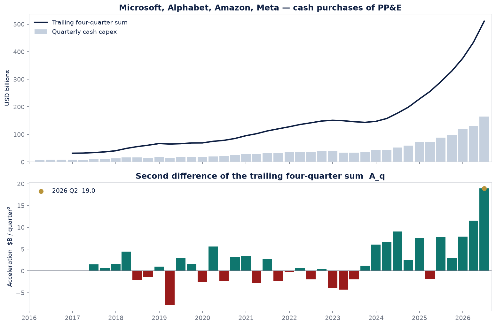
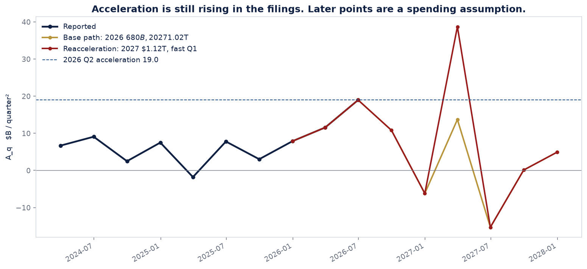
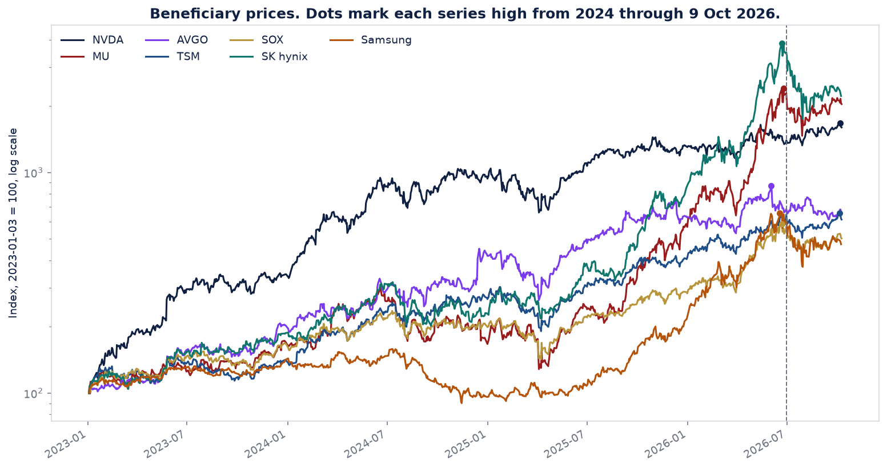
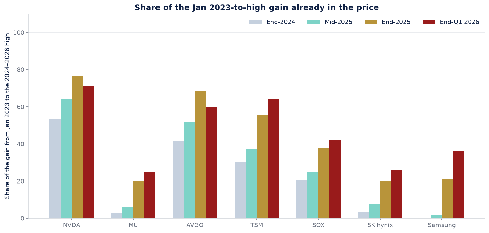
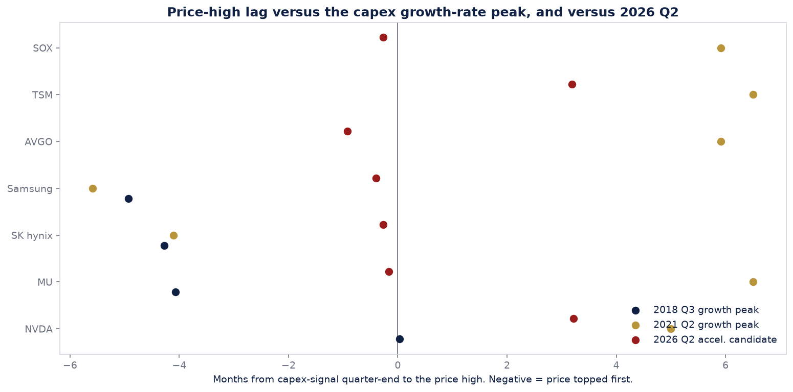

# 하이퍼스케일러 현금 CapEx 가속도 검증

기준일: 현금 CapEx는 2026년 2분기 공시까지, 주가는 2026-10-09까지.
대상: 마이크로소프트, 알파벳, 아마존, 메타의 현금 유형자산 취득액 합계. 비현금 리스 취득액은 빼 두었습니다.

## 결론

공시로 확인되는 가속도 `A_q`는 2026년 2분기에 표본 최대인 **19.0** 입니다. 1분기 11.6에서 아직 올라가는 중입니다. 2026년 2~3분기를 고점으로 보는 판단은 3분기 집행이 2분기 가속도를 넘지 않을 때의 조건부 추정입니다.

3분기 4사 현금 CapEx가 **1,930억 달러**를 넘으면 2분기보다 높은 가속도가 나옵니다. **1,741억 달러**를 밑돌면 가속도 자체가 음수로 돌아섭니다. 그 사이면 가속도는 양수이지만 2분기가 고점으로 남습니다.

주가 고점의 시차는 종목마다 다릅니다. 메모리(삼성전자, SK하이닉스, Micron)와 SOX, Broadcom은 2026년 6월에 고점을 찍고 조정에 들어갔습니다. 시차는 2분기 말 대비 약 0개월입니다. NVDA와 TSMC는 2026년 10월 첫 주에 신고가입니다. 메모리 상승분의 대부분은 2025년까지가 아니라 2026년 상반기에 가격에 들어갔습니다.

## 지표

최근 4분기 합계를 `T_q`라고 하면

- 증가액 `D_q = T_q - T_{q-1} = c_q - c_{q-4}`
- 가속도 `A_q = D_q - D_{q-1}`

`A_q`가 음수라는 것은 전년보다 더 쓰는 금액이 줄어든다는 뜻입니다. 투자액 자체가 줄어든다는 뜻이 아닙니다.

## 2026년 상반기 공시

아래 표의 단위는 십억 달러입니다. 165.1은 1,651억 달러입니다.

| 분기 | MSFT | Alphabet | Amazon | Meta | 합계 | TTM | 증가액 D | 가속도 A | TTM 증가율 |
|---|---:|---:|---:|---:|---:|---:|---:|---:|---:|
| 2025 Q1 | 16.7 | 17.2 | 25.0 | 12.9 | 71.9 | 256.0 | 27.6 | -1.8 | 62% |
| 2025 Q2 | 17.1 | 22.4 | 32.2 | 16.5 | 88.2 | 291.3 | 35.4 | 7.8 | 65% |
| 2025 Q3 | 19.4 | 24.0 | 35.1 | 18.8 | 97.3 | 329.8 | 38.4 | 3.0 | 66% |
| 2025 Q4 | 29.9 | 27.9 | 39.5 | 21.4 | 118.6 | 376.1 | 46.3 | 7.9 | 65% |
| 2026 Q1 | 30.9 | 35.7 | 44.2 | 19.0 | 129.8 | 433.9 | 57.8 | 11.6 | 70% |
| 2026 Q2 | 35.8 | 44.9 | 54.2 | 30.1 | 165.1 | 510.7 | 76.8 | 19.0 | 75% |

2026년 1분기 합계 129.75, 2분기 합계 165.05. 가속도는 11.55, 18.96입니다. 이전에 적었던 1,298억, 1,651억, 11.6, 19와 반올림 범위에서 같습니다.

마이크로소프트 FY2026(2025년 7월~2026년 6월) 현금 CapEx 합계는 **1,159.5억 달러**이며, 10-K의 additions to property and equipment와 일치합니다.

## 고점 분기는 연간 총액만으로 정해지지 않습니다

기본 경로(2026년 4사 현금 6,800억 달러, 2027년 1.02조 달러)를 분기에 풀어 쓰면 2026년 3분기 약 1,849억 달러, 4분기 약 2,000억 달러입니다. 이 경로는 3분기가 1,930억 달러 아래라서 계산상 고점이 2분기에 남고, 2027년 합계는 1.02조 달러입니다.

같은 6,800억 달러라도 3분기에 집행이 몰리면 고점 분기가 바뀝니다. 3분기가 1,930억 달러를 넘고 4분기가 그만큼 작아도 연간 총액은 6,800억 달러일 수 있습니다.

| 확인할 공시 | 기준 | 의미 |
|---|---:|---|
| 2026년 3분기 4사 현금 PP&E | 1,741억 달러 미만 | 가속도가 음수로 전환. 2분기가 고점 |
| 2026년 3분기 4사 현금 PP&E | 1,741억 달러 ~ 1,930억 달러 | 가속도는 양수, 그러나 2분기보다 낮음 |
| 2026년 3분기 4사 현금 PP&E | 1,930억 달러 초과 | 2분기보다 높은 가속도 |
| 2027년 1분기 | 4분기 집행액에 의존 | 4분기를 2,000억 달러로 두면 **2,301억 달러** 초과 시 2026년 2분기를 넘는 새 고점 |

재가속 경로(2027년 1.12조 달러, 연초 집행)의 2027년 1분기 가속도는 38.7로 2026년 2분기 19.0보다 큽니다. 2027년 합계는 1.12조 달러입니다. 이 분기는 가정이 조금만 바뀌어도 움직입니다.

## 성장률 고점과는 다른 시계

TTM 증가율은 2026년 2분기 **75%**까지 계속 올랐습니다. 분기 증가율은 **87%**입니다. 증가율 자체의 고점은 아직 공시에 없습니다.

증가율의 변화(가속도가 아니라 성장률의 1차 차분)는 2024년 3분기에 가장 컸고, 2025년에는 거의 0 근처까지 둔화됐다가 2026년 상반기에 다시 커졌습니다. 그 재가속은 2024년 3분기의 변화폭보다 작습니다. 금액의 2차 차분 `A_q`와 성장률의 변화는 고점 시기가 다릅니다. 이번 검증의 2차 미분은 금액 `C(t)`의 가속도입니다.

골드만삭스 9월 공개 전망으로 인용된 8,000억 → 1.2조 → 1.4조는 오라클 등을 포함한 더 넓은 집합이고, 회계 정의도 이 4사 현금 합계와 다릅니다. 
이 4사의 2025년 현금 합계는 **3,761억 달러**입니다. 여기에 +94%를 곱하면 2026년 약 7,295억 달러이고, 상반기 2,948억 달러를 빼면 하반기 평균이 1,930억 달러를 넘습니다. 그 성장률을 이 4사에 그대로 적용하면 가속도 고점은 2분기가 아닙니다. 4사 현금 6,800억 달러(2025년 대비 약 81%) 경로에서만 2분기 고점이 기본값이 됩니다.

## 과거 성장률 고점과 주가 고점

완료된 TTM 증가율 사이클은 두 개입니다. 고점 이후 6분기 안에 증가율이 15%포인트 이상 내려간 경우만 골랐습니다.

| 성장률 고점 | TTM 증가율 | 이후 6분기 중 저점 |
|---|---:|---:|
| 2018 Q3 | 66% | 4% |
| 2021 Q2 | 44% | 18% |

주가 고점은 성장률 고점 전후 약 9~12개월 안에서, 25% 하락이 나오기 직전의 고가입니다. 한 번 25%가 깨진 뒤의 신고가는 다음 다리로 보고 이 사이클 고점에서 뺍니다. 시차가 음수면 주가가 먼저 고점을 만들었습니다.

| 사이클 | 종목 | 주가 고점 | 시차(개월) | 구간 내 최대 하락 | 판정 |
|---|---|---|---:|---:|---|
| 2018 Q3 성장률 | NVDA | 2018-10-01 | +0.0 | -56% | 25% 하락 |
| 2018 Q3 성장률 | MU | 2018-05-29 | -4.1 | -54% | 25% 하락 |
| 2018 Q3 성장률 | AVGO | 2019-04-17 | +6.5 | -21% | 고점은 있으나 1년 내 25% 하락 없음 |
| 2018 Q3 성장률 | TSM | — | — | — | 구간 안 순환 고점 없음 |
| 2018 Q3 성장률 | SOX | 2019-07-24 | +9.8 | -12% | 고점은 있으나 1년 내 25% 하락 없음 |
| 2018 Q3 성장률 | SK하이닉스 | 2018-05-23 | -4.3 | -39% | 25% 하락 |
| 2018 Q3 성장률 | 삼성전자 | 2018-05-03 | -4.9 | -29% | 25% 하락 |
| 2021 Q2 성장률 | NVDA | 2021-11-29 | +5.0 | -56% | 25% 하락 |
| 2021 Q2 성장률 | MU | 2022-01-14 | +6.5 | -45% | 25% 하락 |
| 2021 Q2 성장률 | AVGO | 2021-12-27 | +5.9 | -29% | 25% 하락 |
| 2021 Q2 성장률 | TSM | 2022-01-14 | +6.5 | -46% | 25% 하락 |
| 2021 Q2 성장률 | SOX | 2021-12-27 | +5.9 | -39% | 25% 하락 |
| 2021 Q2 성장률 | SK하이닉스 | 2021-02-25 | -4.1 | -41% | 25% 하락 |
| 2021 Q2 성장률 | 삼성전자 | 2021-01-11 | -5.6 | -38% | 25% 하락 |

2018년 증가율은 2분기 64%, 3분기 66%, 4분기 64%로 한 분기에 뾰족하지 않습니다. 그 평탄 구간보다 메모리는 4~5개월 먼저 고점을 만들었고, NVDA는 3분기 말과 같은 달입니다. 2021년은 갈립니다. 삼성전자와 SK하이닉스는 증가율 고점보다 4~6개월 앞섰고, NVDA, Broadcom, SOX, TSMC, Micron은 5~7개월 뒤에 고점을 만들었습니다. 2018년의 SOX, Broadcom, TSMC는 그해 하락 이후 가격이 다시 전고점을 넘어서, 이 규칙에서는 그 해 고점이 잠기지 않았습니다.

25% 하락으로 잠긴 고점 11개의 시차 중위값은 +0.0개월입니다. 한국 메모리가 성장률 고점보다 먼저 고점을 만들어서, 전체를 묶으면 약 0개월입니다. 0~9개월 선행, 중위 약 5개월은 2021년 미국 종목(NVDA, Micron, Broadcom, SOX, TSMC) 5개에만 해당하고, 그 중위값은 +5.9개월입니다. 2018년 메모리 고점은 TTM 증가율이 64%로 아직 66%를 향해 오르던 분기에 나왔습니다. 2021년 한국 메모리는 TTM 증가율이 2020년 4분기 38%, 2021년 1분기 37%이던 구간, 44% 고점 전에 고점을 만들었습니다. 2021년 미국 종목은 44%에서 4분기 34%, 2022년 1분기 32%로 내려온 뒤에 고점을 만들었습니다. 2026년 메모리는 TTM 증가율 75%가 아직 오르는 6월에 고점을 만들었습니다. 이 중위값은 완료된 두 사이클의 서술입니다.

## 이번 사이클, 2026년 2분기 후보 기준

아래 시차는 2026년 6월 30일 대비입니다. 2분기가 가속도 고점이라는 전제가 3분기 공시로 깨지면 시차도 다시 재야 합니다.

| 종목 | 2024년 이후 고점 | 10월 9일 대비 고점 낙폭 | 6월 30일 대비 시차 | 상태 |
|---|---|---:|---:|---|
| NVDA | 2026-10-06 | -4% | +3.2개월 | 10월에도 고점 부근. 25% 조정 없음 |
| MU | 2026-06-25 | -15% | -0.2개월 | 고점 후 최대 -39%, 10월 초 -15% |
| AVGO | 2026-06-02 | -25% | -0.9개월 | 고점 후 최대 -30%, 10월 초 -25% |
| TSM | 2026-10-05 | -7% | +3.2개월 | 10월에도 고점 부근. 25% 조정 없음 |
| SOX | 2026-06-22 | -14% | -0.3개월 | 고점 후 최대 -29%, 10월 초 -14% |
| SK하이닉스 | 2026-06-22 | -42% | -0.3개월 | 고점 후 최대 -55%, 10월 초 -42% |
| 삼성전자 | 2026-06-18 | -28% | -0.4개월 | 고점 후 최대 -43%, 10월 초 -28% |

2023년 1월 3일부터 그 고점까지의 상승분 중, 각 시점까지 이미 반영된 비율입니다. NVDA와 TSMC의 고점은 10월 신고가라서 아직 25% 조정으로 확인된 고점이 아닙니다.

| 종목 | 2024말 | 2025 중반 | 2025말 | 2026 1분기말 | 고점까지 배수 |
|---|---:|---:|---:|---:|---:|
| NVDA | 53% | 64% | 77% | 71% | 16.7x |
| MU | 3% | 6% | 20% | 25% | 24.1x |
| AVGO | 41% | 52% | 68% | 60% | 8.7x |
| TSM | 30% | 37% | 56% | 64% | 6.6x |
| SOX | 20% | 25% | 38% | 42% | 5.9x |
| SK하이닉스 | 3% | 8% | 20% | 26% | 38.6x |
| 삼성전자 | -1% | 1% | 21% | 36% | 6.5x |

Micron, SK하이닉스, 삼성전자는 2025년 말까지 사이클 상승분의 약 20%만 반영돼 있었고, 나머지는 2026년 상반기 가격에 들어갔습니다. NVDA는 2025년 말 이미 약 4분의 3이 반영돼 있었고 10월에도 고점 부근입니다.

## 수익률과 가속도의 시차 상관

분기 로그수익률과 `A_q`의 상관은 표본이 작고, 2026년 상반기 메모리 급등이 전체를 끌어올립니다. 2018~2023년만 보면 상관이 가장 큰 시차는 +4분기(평균 상관 +0.40). 2026년 2분기까지 넣으면 +2분기(평균 상관 +0.34). 가격이 가속도를 안정적으로 몇 분기 선행한다는 상관 구조는 이 표본에서 확인되지 않습니다.

## 한계

- 4사 현금 PP&E는 골드만삭스 하이퍼스케일러 총액, 회사 가이던스 CapEx와 범위가 다릅니다. 마이크로소프트는 FY2026 현금 1,159억 달러 위에 금융리스 데이터센터 취득 246억 달러가 따로 있습니다.
- 아마존 2016~2017은 XBRL 계정 변경을 이어 붙인 값입니다. 2018년 이후, 그리고 이번 사이클 판단에는 그 이음새가 들어가지 않습니다.
- 분기 CapEx는 지급 시점에 출렁입니다. `A_q` 한 분기의 고점은 그 출렁임일 수 있어서, 3분기 한 번으로 고점을 확정하지 않는 편이 맞습니다.
- 완료된 성장률 사이클은 두 개입니다. 시차의 중위값을 다음 사이클의 예측으로 쓰면 과합니다.
- 주가는 배당을 재투자하지 않은 분할 조정 종가입니다.

재현: `python scripts/run_capex_acceleration.py`

