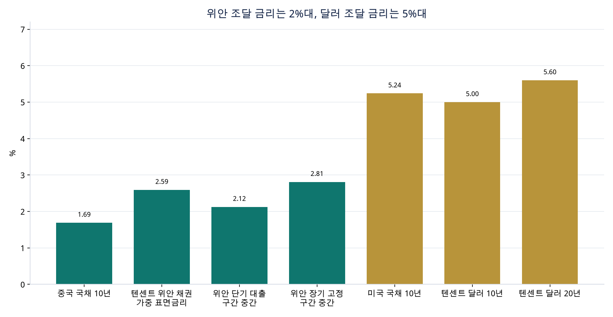
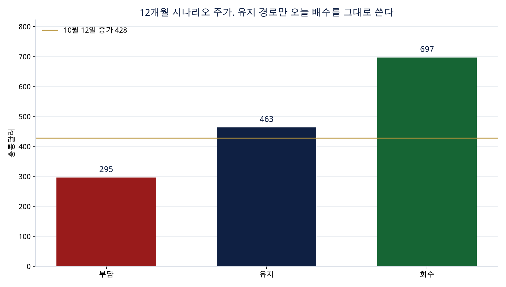

# 텐센트, 돈을 어디에 쓰고 어떤 회사가 되려 하는가

2026년 10월 12일 종가 홍콩달러 428원, 당일 범위 423.40–430.40, 52주 범위 411–664. 위안 환산은 같은 날 CFETS 중간가(홍콩달러 1원 = 0.85768위안)로 주당 367.1위안이다. 주식 수는 약 90.11억 주. 시가총액은 약 3.86조 홍콩달러, 3.31조 위안이다.

이 글의 주가 범위는 예측 모델의 출력이다. 공시가 2027년 이익을 보장하지 않고, 배수도 모델이 고른 값이다.

## 의도

숫자가 보여주는 우선순위는 한 줄이다. 게임·광고·결제에서 나오는 현금으로 AI 인프라를 먼저 사고, 배당은 유지하고, 자사주는 줄였다.

상반기 자본적 지출은 963억 위안으로 2025년 한 해 883억 위안을 이미 넘었다. 작년 상반기보다 지출은 504억 위안 늘었다. 자사주는 345억에서 223억 위안으로 줄었고, 배당은 375억에서 416억 위안으로 늘었다. 주주환원 감소분보다 설비 투자 증가분이 크다. 차액은 단기대출과 예금으로 메웠다.

같이 늘어난 계약이 업의 방향을 말한다. 기타 자본자산 구매 약정은 34억에서 743억 위안, 재무제표에 부채로 잡지 않은 기술·콘텐츠 약정은 552억에서 2,802억 위안이다. 회사는 앞으로 수년의 컴퓨팅과 기술 인프라를 지금 가격과 지금 위안 금리로 잠그고 있다.

채권 제안의 역할은 그 투자 자금을 만기가 짧은 위안 대출에서 긴 채권으로 옮기는 데 가깝다. 6월 말 유동 차입 863억 위안 중 845억이 단기대출이고, 그중 위안 무담보가 704억이다. 회사는 아직 순현금 582억 위안이 있고, 12개월 영업과 자본적 지출은 기존 현금으로 가능하다고 적었다. 유상증자는 하지 않는다. 배수가 낮아진 가격에서 주식을 새로 팔지 않겠다는 선택이다.

AI는 두 층으로 밀고 있다. 광고 추천, AIM+, 클라우드, 게임은 이미 매출로 잡힌다. Hy, 위안바오, CodeBuddy, WorkBuddy, 샤오웨이는 상반기 비IFRS 영업이익을 약 192억 위안 깎는 적자 사업이다. 회사는 이 적자를 숨기지 않고, 빼면 영업이익 성장이 18%라는 방식으로 채권 투자자에게 설명했다. 모델과 앱을 직접 갖고, 위챗으로 배포하겠다는 쪽이다.

해외 게임은 2025년 +33%에서 상반기 +6%로 느려졌다. 국내 게임은 +11%, 소셜은 -0.7%다. 다음 성장의 무게는 해외 게임 흥행보다 위챗 광고와 국내 자체 게임에 실려 있다.

## 앞으로 돈이 가는 곳

이미 나간 상반기 현금과, 하반기를 작년 하반기처럼 가정한 자리다.

| 용도 | 금액 | 의미 |
| --- | ---: | --- |
| 상반기 자본적 지출 | 963억 | IT, 데이터센터, 캠퍼스, 지식재산. 미디어 콘텐츠는 제외 |
| 작년 하반기 자본적 지출 | 424억 | 2025년 883억에서 상반기 459억을 뺀 값 |
| 2026년 지출, 하반기가 작년과 같으면 | 1,387억 | 2025년 대비 +57.1% |
| 2026년 지출, 하반기도 상반기와 같으면 | 1,926억 | 5년 정액 상각이면 매년 약 385억 |
| 상반기 배당 | 416억 | 2025년 연간 배당이 상반기에 지급된 패턴 |
| 상반기 자사주 | 223억 | 2024년 연간 1,023억, 2025년 733억에서 축소 |
| 자본 약정 | 927억 | 이미 계약, 아직 현금 유출 전 |
| 기타 약정 | 2,801억 | 인프라 운영, 게임, 미디어, 기술 서비스. 대부분 12개월 이후 |

상각이 이자보다 크다. 뜨거운 캡엑스 경로를 5년 정액으로 나누면 연 385억 위안이다. 위안 부채 전부를 달러 10년 쿠폰 대신 위안 채권 금리로 빌릴 때 아껴지는 이자는 연 57억 위안이다. AI 투자의 손익은 금리보다 그 설비가 매출을 만드는지에서 갈린다.

신규 AI 제품 적자는 비용의 다른 줄이다. 상반기 약 192억 위안, 2025년 한 해 약 174억 위안. 현금이 설비로 가고, 손익은 새 앱 적자와 감가상각으로 깎인다.

## 어떤 회사가 되는가

2023년 텐센트는 매출 대비 자본적 지출 3.7%, 매출총이익률 48%인 플랫폼이었다. 2026년 상반기는 지출 비중 24%, 매출총이익률 57%다. 본업 마진은 좋아졌고, 자산은 무거워졌다.

남아 있는 이익의 모양은 그대로다. 상반기 매출총이익의 54%가 부가서비스, 성장분의 38%가 마케팅이다. 핀테크·기업서비스는 매출의 30%이고 증가 속도는 한 자릿수다. 다음 모습은 위챗 트래픽으로 광고·클라우드·게임을 팔고, 그 위에 AI 설비를 얹는 회사다.

그래서 3년 뒤의 모습은 세 갈래다.

- 회수. 광고와 클라우드가 AI 설비 값을 벌고, 새 앱 적자가 줄어 플랫폼 마진이 남는다. 게임은 계속 이익의 중심이다.
- 유지. 본업은 고성장 없이 한 자릿수 후반으로 크고, AI 적자는 상반기 속도 근처에 머문다. 회사는 현금 창출원과 설비 투자 회사를 한 몸에 둔다.
- 부담. 설비 약정이 감가상각과 운영비로 먼저 오고 매출은 늦게 온다. 이익은 거의 늘지 않고, 시장은 인터넷 회사 배수 대신 설비 회사 배수를 적용한다.

위챗 월활성 14.39억, 증가율 2%는 이용자 회사의 성장이 끝났다는 뜻이기도 하고, 그 이용자를 더 비싸게 파는 회사로 바뀌었다는 뜻이기도 하다. 광고 단가, 폐쇄 루프 거래, 클라우드 사용량이 계정 수를 대신한다.

## 미국보다 낮은 대출 금리

10월 12일 미국 10년 국채는 약 5.24%, 중국 10년 국채는 약 1.69%다. 차이는 3.55%포인트다.

텐센트의 위안 채권 가중 표면금리는 2.59%다. 원금 240억 위안, 연 이자 약 6.2억 위안. 6월에 직접 발행한 달러 10년은 5.00%, 달러 20년은 5.60%다. 싼 돈은 위안 부채다. 달러 부채는 미국 금리 구간에 있다. 홍콩달러 은행 차입은 HIBOR에 0.08~0.60%포인트를 더하므로 달러 금리에 가깝다.

위안 은행 차입 중 금리가 구간으로 적힌 원금은 1,397억 위안이다. 구간 끝으로 연 이자를 계산하면 22.7억에서 46.1억 위안이다. 중간 금리는 2.46%다. LPR에 연동된 원금 약 716억 위안은 10월 12일 LPR이 이 공시에 없어 이자 금액을 확정하지 않았다.

예시로, 위안 채권·고정구간 대출·LPR 원금을 합친 2,352억 위안 전부를 위안 채권 가중 금리 2.59%로 빌리고, 같은 돈을 자사 달러 10년 쿠폰 5.00%로 빌리면 이자는 매년 57억 위안 차이 난다. 미국 10년 국채 5.24%와 비교하면 차이는 62억 위안이다. 국채 금리는 텐센트가 실제로 빌릴 수 있는 금리가 아니다. 비교 기준은 회사가 6월에 낸 달러 채권이다.

이 차이는 2025년 지배주주 순이익 2,248억 위안의 약 2.5%다. 상반기 AI 적자를 연간으로 그대로 두면 약 385억 위안인데, 금리 차이는 그 적자의 일부만 메운다. 장점은 맞다. 장점이 되는 자리는 한정되어 있다.

- 위안으로 버는 국내 설비에는 통화가 맞다. 데이터센터와 서버를 위안 부채로 사면 이자와 매출의 통화가 같다.
- 10년 위안 2.50%는 단기 위안 0.75~3.50%보다 언제나 싸지 않다. 이번 채권의 이득은 금리 그 자체보다 845억 단기대출의 차환 위험 축소다.
- 10월 제안이 달러로 나오면 이 장점은 그 회차에는 쓰이지 않는다. 6월 달러 채권은 이미 5.00%와 5.60%였다.
- 같은 금리 차이가 주식 배수에는 반대로 작용한다. 미국 무위험 수익률이 5.2%이면 홍콩 주식은 그보다 높은 이익 수익률을 줘야 한다. 오늘 주가의 최근 12개월 IFRS 이익 배수는 14.0배, 이익 수익률 7.1%다. 비IFRS는 12.2배, 이익 수익률 8.2%다. 싼 위안 부채가 회사 이자를 줄이는 동안, 높은 미국 금리는 외국인 주주가 요구하는 수익률을 높여 배수를 눌러 둔다.

52주 고가 664홍콩달러에서 428홍콩달러까지 가격은 약 -35.5%다. 같은 기간 이익은 늘었다. 가격 하락의 중심은 배수 하락이다.

## 지금 주가의 위치

중간보고서 상반기 기본 주당순이익은 12.639위안이다. 공시 지배주주 순이익 1,141.15억 위안을 가중평균 90.29억 주로 나누면 12.639위안이라 중간보고서와 맞다. 작년 상반기 11.367위안, 가중평균 91.01억 주로 되돌리면 지배주주 순이익은 1,034.5억 위안, 증가율은 10.3%다. 회사가 말한 약 10%와 같다.

최근 12개월 IFRS 지배주주 순이익은 2025년 연간에서 작년 상반기를 빼고 올해 상반기를 더해 2,355억 위안, 주당 26.14위안, 배수는 14.0배다. 비IFRS는 상반기 10% 성장률을 정확한 값으로 본 참고치라 주당 30.2위안, 12.2배다.

## 12개월 주가 범위

2027년 10월을 본다. 그때 시장이 2027년 비IFRS 지배주주 순이익에 배수를 곱한다고 둔다. 주식 수는 90.11억 주로 고정했다. 자사주가 더 줄면 주당 가치는 같은 이익에서 그만큼 올라간다.

경로는 2025년 AI 제외 비IFRS 영업이익 2,981억 위안에서 출발한다.

| 경로 | AI 제외 영업이익 성장 | AI 적자 | 순이익 전환 | 2027년 추가 성장 | 이 경로의 배수 |
| --- | ---: | ---: | ---: | ---: | ---: |
| 회수 | +16.0% | 250억 | 92.0% | +14.0% | 16.0배 |
| 유지 | +12.0% | 340억 | 90.0% | +9.0% | 12.2배 |
| 부담 | +6.0% | 420억 | 86.0% | +2.0% | 9.5배 |

유지 경로의 배수는 오늘 비IFRS 배수 12.2배를 그대로 쓴다. 회수는 16배, 부담은 9.5배다. 16배는 52주 고점 무렵의 IFRS 배수보다 낮다.

| 경로 | 2027년 비IFRS 지배순이익 | 주당 위안 | 10.0배 | 12.5배 | 16.0배 |
| --- | ---: | ---: | ---: | ---: | ---: |
| 회수 | 3,365억 | 37.3 | 435 | 544 | 697 |
| 유지 | 2,942억 | 32.6 | 381 | 476 | 609 |
| 부담 | 2,403억 | 26.7 | 311 | 389 | 498 |

각 경로에 그 경로의 배수를 곱한 주가는 다음과 같다.

- 회수: 홍콩달러 697원, 종가 대비 +62.7%. 새 앱 적자가 줄고 배수가 16배까지 회복하는 경우다.
- 유지: 홍콩달러 463원, 종가 대비 +8.1%. 이익은 늘고 배수는 오늘과 같다.
- 부담: 홍콩달러 295원, 종가 대비 -31.0%. 이익이 거의 늘지 않고 배수가 9.5배로 더 내려가는 경우다.

기준점으로 삼을 숫자는 유지 경로의 약 463홍콩달러다. 오늘 428홍콩달러와의 차이는 대부분 2년 치 이익 성장이다. 배수 회복을 가격에 넣지 않았다. 회수 경로 약 697홍콩달러는 이익과 배수가 같이 좋아지는 경우이고, 부담 경로 약 295홍콩달러는 설비 투자가 이익으로 바뀌기 전에 배수가 더 낮아지는 경우다. 세 숫자의 간격이 이 종목의 실제 불확실성이다.

외부 화면의 평균 목표가가 660홍콩달러 안팎인 곳이 있다. 그 가격은 52주 고가 664홍콩달러와 겹친다. 이 모델은 그 목표가를 쓰지 않는다.

## 이 범위가 깨지는 자리

10월 제안이 달러 5%대 채권으로 정해지면 그 회차의 금리 차이는 줄고, 위안 매출과의 통화 차이는 커진다. AI 적자가 2025년 174억 위안 쪽으로 다시 줄면 유지 경로의 이익이 회수 쪽으로 이동한다. 약정 2,802억 위안이 짧은 기간에 현금으로 나가면 순현금 582억은 소진되고, 부담 경로의 배수가 먼저 반응한다. 국내 게임 흥행이 빠지고 광고 성장이 10% 밑으로 내려가면 매출 가정의 출발점 자체가 달라진다.
