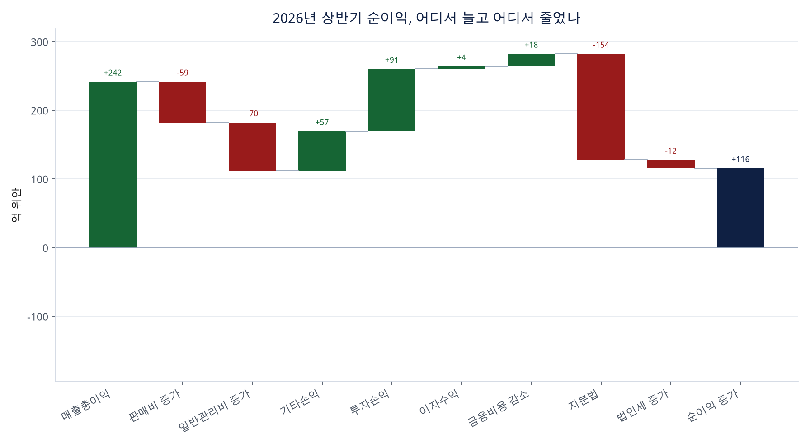
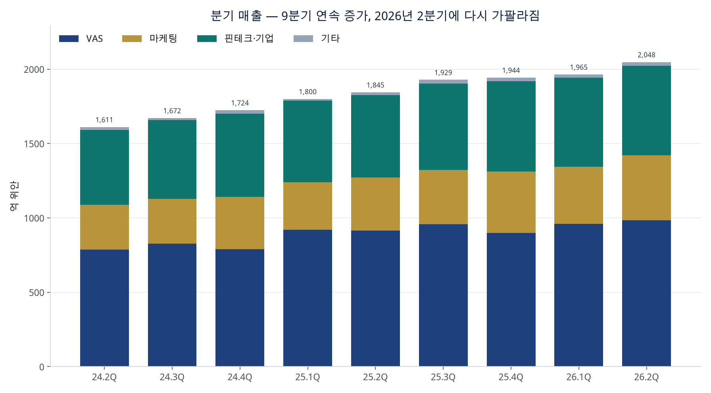
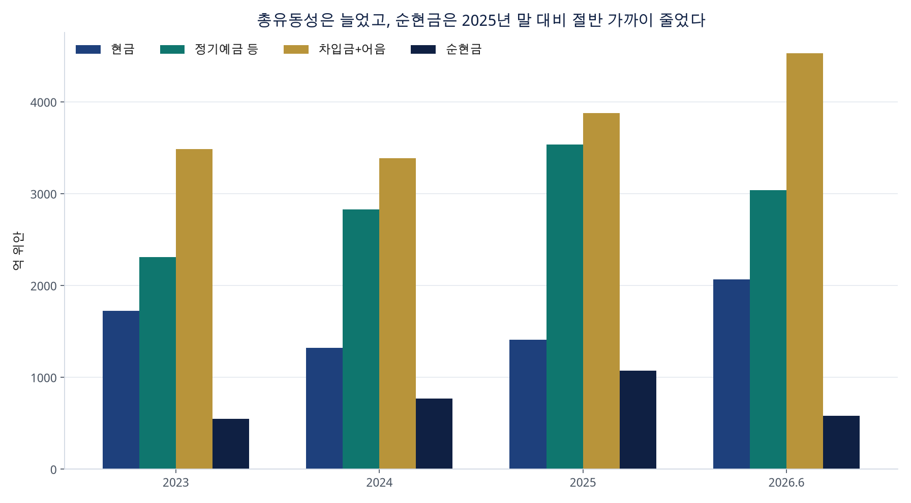
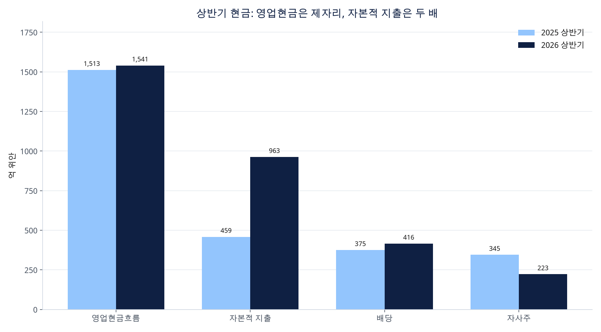

# 텐센트(0700.HK) 2026년 10월 12일 중기채권 공시 분석

출처는 텐센트홀딩스가 2026년 10월 12일 홍콩거래소에 낸 「글로벌 중기채권 프로그램에 따른 채권 발행 제안 및 재무자료 요약」이다. 아래 수치는 그 원문(인민폐 백만 위안)을 코드로 다시 더한 결과다. 검증 127건은 모두 통과했다. 이 글은 공시 독해이며 투자 권유가 아니다. 분기·반기 숫자는 미감사, 2023~2025년 연간 본표는 감사 기준이다.

## 한 줄

본업 매출은 2026년 상반기 10.1% 늘어 4,012.43억 위안이다. 이익의 중심은 여전히 게임이고, 성장의 중심은 광고로 옮겨 갔다. 신규 AI 제품이 비IFRS 영업이익을 상반기에만 192억 위안 깎았고, 자본적 지출은 상반기 963억 위안으로 1년 전 상반기의 두 배를 넘었다. 6월 말 순현금은 582억 위안으로 2025년 말 1,071억 위안보다 줄었고, 회사는 그 위에서 전문투자자 대상 추가 채권 발행을 제안했다. 구속력 있는 계약은 없다.

## 이번 공시에서 확정된 것

텐센트홀딩스(케이맨 법인, 홍콩 700 홍콩달러 카운터·80700 위안 카운터)가 기존 글로벌 중기채권 프로그램으로 전문투자자에게 채권을 국제 발행하겠다고 밝혔다. 시리즈로 나누고, 발행일과 조건은 달라질 수 있으며, 통화는 제한하지 않았다. 미국 안에서는 1933년 증권법 144A의 적격기관투자자, 미국 밖에서는 Regulation S의 역외 거래로 팔 수 있다. 홍콩·미국·그 밖 어디에서도 공개모집은 없고, 상장규칙상 연결인에게도 배정하지 않는다. 채권의 홍콩거래소 상장을 추진한다. 상장이나 시세는 회사나 채권의 가치 평가가 아니라고 적어 두었다.

공동 글로벌 코디네이터는 공시 순서로 JP모간, 공상은행(아시아), 농은국제, 중국은행(홍콩), 교통은행 홍콩지점, 건설은행(아시아), 중신라이온(CLSA), 골드만삭스 아시아, HSBC, 모건스탠리다.

공시일까지 구속력 있는 발행 계약은 없다. 성사는 글로벌 시장, 회사의 자금 수요, 투자자 관심에 달렸다. 프로그램 한도 금액, 이번 트렌치의 규모·만기·통화·쿠폰은 이 본문에 없다. 재무 요약은 투자설명서용 경영진 논의를 주주와 시장에 같이 공개한 것이다. 의장 마화텅 명의, 날짜는 2026년 10월 12일이다.

달러 병기 금액은 회사가 2026년 6월 30일 기준으로 편의 환산한 값이다. 상반기 매출 4,012.43억 위안 = 591.36억 달러에서 역산한 환율은 1달러 = 6.7851위안이다.

## 실적

|  | 2023 | 2024 | 2025 | 2025 상반기 | 2026 상반기 |
| --- | ---: | ---: | ---: | ---: | ---: |
| 매출 | 6,090억 | 6,603억 | 7,518억 | 3,645억 | 4,012억 |
| 매출 성장 |  | +8.4% | +13.9% |  | +10.1% |
| 매출총이익률 | 48.1% | 52.9% | 56.2% | 56.4% | 57.2% |
| 영업이익 |  | 2,081억 | 2,416억 | 1,177억 | 1,347억 |
| 영업이익률 |  | 31.5% | 32.1% | 32.3% | 33.6% |
| 순이익 | 1,180억 | 1,965억 | 2,298억 | 1,058억 | 1,174억 |
| 순이익률 | 19.4% | 29.8% | 30.6% | 29.0% | 29.3% |

매출총이익률 경로: 48.1% → 52.9% → 56.2% → 56.4% → 57.2%. 회사 반올림 기준으로는 2023년 48%에서 2026년 상반기 57%다. 상반기 매출총이익은 +11.8%로 매출 성장 +10.1%보다 빨랐다. 증가분 매출총이익률은 65.9%다.

상반기 영업이익은 1,346.51억 위안, +14.4%다. 순이익은 1,173.69억 위안, +11.0%다. 지배주주 귀속 순이익은 공시 기준 1,141.15억 위안, 약 10% 증가다. 비IFRS 지배주주 순이익은 1,363.20억 위안, 약 10% 증가다. 상반기 순이익률은 29.0%와 29.3%로, 회사가 말한 대로 29%에 머문다.

2025년 연간 네 분기를 더하면 매출·부문 매출·매출총이익·영업이익·세전이익·순이익·이자·금융비용·지분법·투자손익이 연간 공시와 원 단위로 일치한다.

## 사업부 — 성장은 광고, 이익은 게임

2026년 상반기 매출 증가분 367억 위안의 기여도는 마케팅 38.5%, 부가서비스 30.0%, 핀테크·기업서비스 26.5%, 기타 5.0%다. 2025년 연간 증가분은 부가서비스가 54.8%로 가장 컸다. 2026년 상반기에 성장의 가장 큰 조각이 광고로 바뀌었다.

| 부문 | 상반기 매출 | 성장 | 비중 변화 | 매출총이익률 | 증가분 마진 | 매출총이익 비중 |
| --- | ---: | ---: | ---: | ---: | ---: | ---: |
| 부가서비스 | 1,945억 | +6.0% | 50.3% → 48.5% | 60.0% → 63.3% | 117.2% | 53.6% |
| 마케팅 | 817억 | +20.9% | 18.5% → 20.4% | 56.6% → 56.2% | 54.4% | 20.0% |
| 핀테크·기업 | 1,202억 | +8.8% | 30.3% → 29.9% | 51.2% → 52.1% | 62.2% | 27.3% |
| 기타 | 48억 | +62.2% | 0.8% → 1.2% | 18.3% → -39.7% | -133.1% | -0.8% |

부가서비스 매출총이익률이 60%에서 63%로 오른 이유는 원가가 같이 오르지 않았기 때문이다. 부가서비스 원가는 734억에서 715억 위안으로 줄었고, 증가분 마진이 100%를 넘는다. 회사는 고마진 자체 개발 게임 비중을 이유로 든다.

게임·소셜은 억 단위 반올림 공시다.

- 국내 게임 927억 위안, +11.0%. 《델타포스(三角洲行動)》, 《발로란트(無畏契約)》, 《발로란트 모바일(無畏契約：源能行動)》, 《로코킹덤: 월드(洛克王國：世界)》, 《명조(鳴潮)》.
- 해외 게임 374억 위안, +6.0%. 《클래시 로얄》, 《명조》, 《VALORANT》. 2025년 연간 해외 게임은 774억 위안, +33.0%(고정환율 +32%)였다. 상반기 6%는 그 속도가 크게 낮아진 자리다. 2025년 해외 기여작은 슈퍼셀, PUBG 모바일, 명조였다.
- 소셜 네트워크 644억 위안, -0.7%. 2024년 +2.0%, 2025년 +5.0% 뒤에 나온 감소다. 세 항목 합은 1945억으로 부가서비스 1,945.24억과 맞다.

마케팅은 3년째 가장 빠른 큰 사업이다. 2024년 +19.6%, 2025년 +19.4%, 2026년 상반기 +20.9%. 회사가 든 장치는 세 가지다. AI 광고 추천(노출마다 이용자에게 무엇을 보여줄지), 스마트 집행 상품 텐센트 마케팅 AIM+(광고주가 좋은 노출을 사게 하는 도구), 위챗 안 폐쇄 루프(미니게임·위챗 샵이 텐센트 광고 지면에서 바로 판매로 이어짐)다. 상반기 주요 업종 대부분의 광고비가 늘었다. 매출총이익률은 원단위로 56.6%에서 56.2%다. 회사 반올림은 57%에서 56%다. 광고·콘텐츠 추천용 AI 인프라 감가상각과 운영비가 매출 증가와 거의 같이 늘었다.

핀테크·기업서비스는 +8.8%. 금융 쪽은 상업 결제, 재테크, 소비대출이다. 기업서비스 쪽은 클라우드이고, 이유는 AI 수요, 해외 확장, 가격 환경이다. 매출총이익률은 51%에서 52%다. 2023년 이 부문 마진은 40%였다. 3년 사이에 원가 구조가 이미 한 단계 올라와 있다.

기타(영화·드라마 투자·제작·배급, 콘텐츠 라이선스, 상품)는 매출이 +62.2% 늘었는데 원가율이 81.7%에서 139.7%로 올라 매출총손실 19.1억 위안이다. 그룹 매출의 1%라 전사 마진을 바꾸지는 못한다. 원인 분해는 공시에 없다.

이용자 수는 거의 늘지 않았다. 2026년 6월 30일 위챗·WeChat 합산 월활성 계정 14.39억, 1년 전 14.11억 대비 +2.0%. QQ 모바일 월활성은 5.20억이고 비교 수치는 없다. 매출 성장은 계정 수보다 결제, 광고 단가, 클라우드 사용에서 나온다.

## 이익의 질

상반기 영업이익 증가 170억 위안을 나누면 매출총이익 +241.9억 , 판매비 증가분 차감 -59.4억, 일반관리비 증가분 차감 -70.2억, 기타손익 개선 57.5억이다.

판매비는 232.12억 위안, +34.4%다. 매출 대비로는 4.7%에서 5.8%다. 회사 반올림은 5%에서 6%다. 용도는 게임과 AI 네이티브 제품 보급이다. 일반관리비는 726.08억 위안, +10.7%이고 매출 대비 18%로 반기 전체는 그대로다. 중에는 Hy 모델 업그레이드, 위챗 AI, 제품별 AI 기능이 들어 있다. 2분기만 보면 일반관리비율은 19.0%로 1년 전 2분기 17.3%보다 높다. 상반기 평균이 18%로 맞는 것은 1분기 비중이 낮았기 때문이다.

기타손익(보조금·세금 환급)은 작년 상반기 순손실 49.8억에서 올해 순이익 7.7억으로 바뀌어 영업이익 증가분의 약 33.8%를 설명한다. 기타손익을 뺀 영업손익은 1,226억에서 1,339억 위안, +9.2%다. IFRS 영업이익 +14.4%와 나란히 보면, 헤드라인 영업이익에는 환급·보조금 스윙이 들어 있다.

비IFRS 영업이익은 1,512.63억 위안, 공시 기준 약 9% 증가다. 회사가 빼는 항목은 주식보상, 투자회사 손익, 인수 무형자산 상각, 손상, 지속가능 사회가치·공동부유 기부, 비경상 컴플라이언스 비용, 일부 소송 합의, 관련 세금이다. 신규 AI 제품을 추가로 빼면 비IFRS 영업이익은 1,705억 위안, 약 18% 증가다. 두 금액의 차이 약 192억 위안이 상반기 신규 AI 제품(Hy, 위안바오, CodeBuddy, WorkBuddy, 샤오웨이)의 비IFRS 영업 적자다. 2025년 한 해의 같은 차이는 약 174억 위안이다. 상반기 6개월 적자가 작년 12개월 적자보다 이미 크다. 신규 AI를 뺀 영업이익이 억 단위로 공시되어, 억 미만은 반올림이다.

AI는 손익계산서에서 두 층이다. 위 적자는 새 앱·모델 층이다. 광고 추천, AIM+, 클라우드 AI 수요, 게임 운영은 기존 사업 매출 안에 이미 잡혀 있고, 이쪽은 상반기 마케팅 +20.9%와 클라우드 성장의 이유로 적혀 있다. 일반관리비 증가는 두 층에 걸친다. 새 제품 적자와 일반관리비 증가를 단순 합산하면 같은 돈을 두 번 센다.

세전이익으로 내려가면 지분법이 방향을 뒤집는다. 상반기 지분법 손익은 91억 위안 이익에서 63.7억 위안 손실로 바뀌었다. 회사는 비상장 투자회사 한 곳의 기업가치 상승이 그 회사가 발행한 전환·상환 우선주의 공정가치 손실로 잡혔고, 텐센트가 지분법으로 그 손실을 떠안았다고 설명한다. 이 금액은 비IFRS에서 제거된다. 비IFRS 지분법 이익은 134.82억 위안, 작년 상반기 139.88억 위안이다. 포트폴리오 가치 상승이 IFRS 순이익에는 손실로 보이는 자리다. 투자손익및기타는 상반기 131.12억 위안 이익이라, 평가 관련 항목은 줄 사이에서 크게 오갔다.

금융비용은 59.58억 위안으로 작년 상반기보다 줄었다. 회사는 환차익과 평균 금리 하락을 이유로 든다. 2025년 연간에는 반대로 환차손이 금융비용을 키웠다. 이 줄은 분기마다 노이즈가 크다.

법인세 유효세율은 상반기 19.2%에서 18.3%다. 중국 일반 25%, 고신기술 15%, 홍콩 16.5%가 섞인 결과다. 케이맨·영국령 버진아일랜드는 법인세가 없다. 2008년 이후 중국 내 이익의 해외 배당에는 보통 10%, 홍콩 주주가 조건을 맞추면 5% 원천세가 있다.

아래 그림의 막대 합은 순이익 증가 116.0억 위안과 같다. 코드 검증값 116.0억 위안. 이자수익과 금융비용 감소는 막대가 얇다. 금액은 각각 3.6억 위안, 18.4억 위안이다.

## 분기 — 2분기 영업은 유지, 순이익 증가율만 꺾임

표에 있는 9개 분기 매출은 직전 분기보다 모두 크다. 2025년 4분기와 2026년 1분기는 전기 대비 1% 안팎이었고, 2026년 2분기는 +4.2%로 다시 벌어졌다. 전년 동기 매출 성장은 2026년 1분기 +9.1%까지 낮아졌다가 2분기 +11.0%다.

| 분기 | 매출 | 전년비 | 전기비 | 매출총이익률 | 영업이익 | 영업이익률 | 영업 전년비 | 순이익 | 순이익률 | 순이익 전년비 |
| --- | ---: | ---: | ---: | ---: | ---: | ---: | ---: | ---: | ---: | ---: |
| 25Q2 | 1,845억 | +14.5% | +2.5% | 56.9% | 601억 | 32.6% | +18.5% | 560억 | 30.4% | +15.9% |
| 25Q3 | 1,929억 | +15.4% | +4.5% | 56.4% | 636억 | 33.0% | +19.2% | 649억 | 33.7% | +20.3% |
| 25Q4 | 1,944억 | +12.7% | +0.8% | 55.7% | 603억 | 31.0% | +17.2% | 591억 | 30.4% | +14.8% |
| 26Q1 | 1,965억 | +9.1% | +1.1% | 56.6% | 674억 | 34.3% | +17.0% | 594억 | 30.2% | +19.4% |
| 26Q2 | 2,048억 | +11.0% | +4.2% | 57.8% | 673억 | 32.9% | +11.9% | 580억 | 28.3% | +3.4% |

2026년 2분기 영업이익은 673억 위안으로 1분기 674억 위안과 같다. 순이익은 580억 위안, 전기 대비 -2.4%, 전년 대비 +3.4%다. 2분기 지분법이 -100억 위안, 투자손익이 112억 위안이다. 영업 밖에 있는 평가 항목이 2분기 순이익 증가율을 3%대로 눌렀다.

2분기 부문 전년 성장은 부가서비스 +7.7%, 마케팅 +21.8%, 핀테크·기업 +8.6%다. 마케팅 436억 위안은 이 9개 분기 중 가장 크다.

## 현금, 약정, 부채 — 채권 제안이 놓인 자리

상반기 영업현금흐름은 1,540.61억 위안, +1.8%다. 매출 성장 +10.1%, 영업이익 성장 +14.4%보다 훨씬 느리다. 매출 대비 영업현금흐름은 41.5%에서 38.4%로 낮아졌다. 납부 법인세는 329억 위안이다. 반기 운전자본 내역은 공시에 없어 더 쪼개지 않는다.

자본적 지출(IT 인프라, 데이터센터, 토지사용권, 캠퍼스, 지식재산, 미디어 콘텐츠 제외)은 매출 대비 3.7% (227억) → 10.9% (721억) → 11.7% (883억) → 12.6% (459억) → 24.0% (963억)다. 여기서 쓰는 잉여현금은 영업현금흐름에서 이 자본적 지출을 뺀 값이다. 배당과 자사주를 빼기 전이다.

|  | 2023 | 2024 | 2025 | 2025 상반기 | 2026 상반기 |
| --- | ---: | ---: | ---: | ---: | ---: |
| 영업현금흐름 | 2,220억 | 2,585억 | 3,031억 | 1,513억 | 1,541억 |
| 자본적 지출 | 227억 | 721억 | 883억 | 459억 | 963억 |
| 잉여현금 | 1,993억 | 1,864억 | 2,148억 | 1,054억 | 578억 |
| 배당+자사주 | 648억 | 1,312억 | 1,108억 | 721억 | 639억 |
| 환원 후 잉여현금 | 1,345억 | 552억 | 1,039억 | 333억 | -61억 |

2025년 한 해는 자본적 지출과 주주환원 뒤에도 1,039억 위안이 남았다. 2026년 상반기는 환원 후 -61억 위안이다. 상반기 사용액(자본적 지출 963억 + 배당·자사주 639억 = 1,602억)이 영업현금흐름 1,541억보다 크다. 배당은 416억 위안, 자사주는 223억 위안이다. 환원 합계는 작년 상반기 721억 위안보다 작은 639억 위안이다. 상반기에 현금 사용을 키운 항목은 자본적 지출이다.

6월 말 현금 2,069억 위안, 유동·비유동 정기예금 등 3,042억 위안, 합친 총유동성 5,112억 위안이다. 2025년 말보다 총유동성은 163억 위안 늘었다. 차입금과 지급어음은 652억 위안 늘었다. 순현금(현금+정기예금등−차입금−어음)은 1,071억에서 582억 위안이 됐다. 아직 순현금이다. 회사는 현금, 영업현금흐름, 정기예금으로 앞으로 최소 12개월 영업과 자본적 지출을 감당할 수 있다고 밝혔다.

앞으로의 청구서는 두 줄이다.

- 자본 약정 927억 위안. 2025년 말 208억 위안. 이 중 기타 자본자산 구매 약정이 34억에서 743억 위안으로 늘었다.
- 재무제표에 부채로 잡지 않은 기타 약정(기술 인프라 운영, 게임 퍼블리싱, 미디어 콘텐츠, 기타 기술 서비스) 2,801.5억 위안. 2025년 말 551.9억 위안. 일부는 12개월 안, 대부분은 12개월 뒤에 지급한다.

두 줄을 단순히 더하면 3,729억 위안이다. 항목이 겹치는지, 몇 년에 걸쳐 나가는지는 공시가 말하지 않는다. 규모만 보면 2025년 영업현금흐름 3,031억 위안과 같은 자릿수다.

차입금은 6월 말 2,989억 위안, 지급어음 1,540억 위안, 합계 4,529.63억 위안(667.6억 달러)이다. 유동 차입 863억 위안 가운데 장기차입의 1년 내 상환은 18억 위안뿐이고, 나머지 845억 위안은 단기대출이다. 위안 무담보 단기대출만 704억 위안이다. 2025년 말 유동 차입 총액은 426억 위안이었다. 늘어난 부채의 중심은 곧 만기가 돌아오는 위안 단기대출이다. 장기 은행차입 만기는 2~5년에 1,828억 위안으로 몰려 있고, 1년 안 상환은 작다.

6월 30일 단기 원금과 금리(공시): 위안 원금 705.73억은 연 0.75~3.50%, 위안 원금 1.58억은 1년물 LPR에서 0.30~0.70%포인트를 뺀 금리, 홍콩달러 159.80억은 HIBOR+0.08~0.10%, 달러 0.30억은 3.70%다. 위 유동 차입 704억은 이 위안 무담보 단기대출의 장부금액이다. 원금과 장부금액은 할인·환산 차이만큼 다르다. 장기 위안은 고정 2.52~3.10% 또는 LPR 가산·차감, 장기 달러 69억은 SOFR+CAS+0.80%, 유로 20.80억은 EURIBOR+0.70~0.75%다. 회사는 변동금리 차입 일부에 금리스왑을 걸어 두었다고 밝혔다.

매출채권은 499억에서 556억 위안, 6개월간 +11.4%다. 광고·클라우드·콘텐츠·외부 플랫폼 매출이 외상 매출의 중심이고, 부가서비스는 선불 비중이 크다. 광고 믹스가 높아지면 매출채권이 매출보다 빨리 늘 여지가 있다. 매입채무는 1,211억에서 1,756억 위안, +45.0%다.

## 이미 발행한 채권과 이번 제안

2026년 6월 16일 발행분 액면을 발행가격으로 곱하고, 위 편의 환율 6.7851로 바꾸면 약 315.7억 위안이다. 상반기 자금흐름의 어음 발행 순유입 315.92억 위안과 1% 안에서 맞다. 발행일 환율과 수수료 때문에 완전 일치는 아니다. 10월 제안은 이 6월 발행과 별개의 추가 제안이다.

| 6월 16일 발행 | 액면 | 표면금리 | 발행가 | 만기 |
| --- | ---: | ---: | ---: | --- |
| 2036년 달러 | 17.5억 달러 | 5.00% | 99.689% | 2036-06-16 |
| 2036년 위안 | 110.0억 위안 | 2.50% | 100.000% | 2036-06-16 |
| 2046년 달러 | 7.0억 달러 | 5.60% | 99.571% | 2046-06-16 |
| 2056년 위안 | 40.0억 위안 | 3.10% | 100.000% | 2056-06-16 |

| 2025년 9월 23일 위안 채권 | 액면 | 표면금리 |
| --- | ---: | ---: |
| 2030년 9월 위안 | 20억 위안 | 2.10% |
| 2035년 9월 위안 | 60억 위안 | 2.50% |
| 2055년 9월 위안 | 10억 위안 | 3.10% |

6월 달러 채권 표면금리는 5.00%와 5.60%다. 같은 날 위안 채권은 2.50%와 3.10%다. 2025년 9월 위안 채권은 2.10~3.10%였다. 달러 장기 자금과 위안 장기 자금의 표면 비용 차이가 이번 스택에서 분명히 드러난다. 10월 제안은 통화가 정해져 있지 않다. 이후 공시에서 볼 항목은 통화, 만기, 쿠폰, 규모, 그리고 단기대출을 얼마나 장기 채권으로 바꾸는가이다.

상반기 금융활동 현금 유출은 94.7억 위안으로, 작년 상반기 301억 위안보다 작다. 배당과 자사주, 이자, 상환이 있었고, 단기차입 유입 577.33억 위안과 어음 발행이 그 유출을 대부분 채웠다.

## 구조와 리스크 가운데 공시가 직접 말한 것

중국 내 매출의 상당 부분은 외상독자법인과 종합연결실체 사이의 계약 약정으로 연결된다. 회사는 법률이 허용하는 범위에서 그 지분과 자산을 살 권리와 실질 지배가 있고, 경제적 위험과 효익이 이전되므로 연결이 적절하다고 판단한다.

외화 노출은 홍콩달러, 달러, 유로가 중심이다. 해외 자회사 기능통화는 대부분 달러, 중국 본토는 위안이다. 공정가치 투자자산의 가격 위험은 포트폴리오를 나누어 관리한다고 했다. 매출채권 신용 기간은 대체로 90일 이내이고, 고객이 분산되어 있다고 했다. 금융서비스 대출은 6월 말 장부 원가의 대부분이 기대신용손실 1단계이고, 상반기 관련 손상은 중대하지 않다고 했다.

전망 진술은 현행 정보와 가정에 기초하며, 회사는 갱신 의무가 없다고 면책했다. 제안 발행 자체가 실현되지 않을 수 있다고 두 번 적었다.

## 이 본문에 없는 것

총자산, 자본, 희석 주식 수, 주당 지표, 프로그램 한도, 이번 트렌치 규모는 없다. 그래서 부채비율이나 주당가치는 계산하지 않았다. 자본적 지출과 기타 약정이 AI 인프라와 얼마나 겹치는지도 없다. 2024년 1분기 이전이 9개 분기 표에 없어, 그 이전의 전년 분기 성장은 이 표만으로 계산하지 않았다. 게임 세부 매출은 억 단위라 그 합은 백만 위안 부문 매출과 1억 위안 안에서만 맞춘다.

비IFRS 성장률 9%와 18%를 정확한 값으로 보고 작년 상반기 신규 AI 적자를 되돌리면 약 57억 위안이다. 두 성장률은 정수 반올림일 수 있어 이 비교치는 참고용이다. 올해 상반기 약 192억 위안과 2025년 연간 약 174억 위안은 공시된 두 금액을 뺀 값이다.
